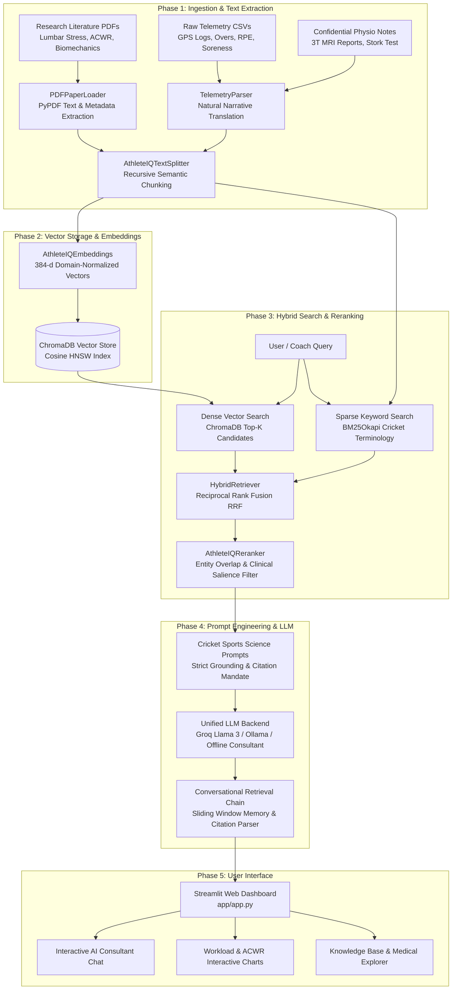

# 🏏 AthleteIQ: Cricket Sports Science & Biomechanics Hybrid RAG System

> **A high-performance Hybrid Retrieval-Augmented Generation (RAG) platform bridging peer-reviewed sports science literature with private player GPS telemetry to prevent lumbar stress fractures and optimize pace bowling workload.**

---

## 📌 Executive Summary & Clinical Context

In elite cricket, fast bowling is one of the most physically demanding activities in professional sport. Fast bowlers experience front-foot ground reaction forces ranging between **6.0 to 9.0 times body weight** within 25–40 milliseconds of delivery stride impact. When repetitive bowling occurs under excessive **shoulder counter-rotation (>30° in a mixed bowling action)** and an unmanaged **Acute:Chronic Workload Ratio (ACWR > 1.50)**, bone fatigue outpaces osteoblastic remodeling, frequently causing bone marrow edema and career-threatening spondylolysis of the contralateral **L4–L5 pars interarticularis**.

**AthleteIQ** solves this multi-disciplinary challenge by synthesizing two previously isolated data domains:
1. **Public Sports Science Literature**: Peer-reviewed studies on fast bowling kinematics, ground reaction forces, Gabbett's ACWR model, and delivery stride counter-rotation.
2. **Private Team Telemetry & Medical Records**: Catapult GPS tracking logs (PlayerLoad, high-speed running, overs bowled, velocity, RPE, sleep) and confidential 3T MRI physiotherapist reports.

---

## 🏗️ System Architecture



---

## 📂 Project Structure

```
AthleteIQ/
│
├── data/                               # Storage for all raw & preprocessed data
│   ├── public_papers/                  # PubMed/arXiv research PDFs on cricket sports science
│   │   ├── fast_bowling_lumbar_stress.pdf
│   │   ├── acute_chronic_workload_cricket.pdf
│   │   └── shoulder_counter_rotation_biomechanics.pdf
│   └── private_telemetry/              # Confidential team tracking & physio records
│       ├── raw_csvs/                   # GPS logs, overs bowled, wellness scores
│       │   └── player_daily_metrics.csv
│       ├── parsed_txt/                 # Preprocessed text summaries of player metrics
│       │   └── player_daily_summaries.txt
│       └── medical_reports/            # Physiotherapist and doctor notes
│           └── player_9_physio_notes.txt
│
├── vectorstore/                        # Local persistent ChromaDB index
│   └── .gitkeep                        # Holds directory structure before database creation
│
├── src/                                # Core Python source code
│   ├── __init__.py
│   │
│   ├── data_ingestion/                 # Phase 1: Preprocessing & Text Extraction
│   │   ├── __init__.py
│   │   ├── pdf_loader.py               # Extract text & metadata from research PDFs
│   │   ├── telemetry_parser.py         # Convert CSV metrics into natural text sentences
│   │   └── text_splitter.py            # Chunking logic (RecursiveCharacterTextSplitter)
│   │
│   ├── vector_engine/                  # Phase 2: Embeddings & Vector Storage
│   │   ├── __init__.py
│   │   ├── embeddings.py               # Local Hugging Face embedding initializer
│   │   └── db_manager.py               # ChromaDB creation, loading, and persistence
│   │
│   ├── retrieval/                      # Phase 3: Hybrid Search & Reranking
│   │   ├── __init__.py
│   │   ├── bm25_retriever.py           # Sparse keyword search for medical & cricket terms
│   │   ├── hybrid_retriever.py         # Ensemble retriever (BM25 + Dense Vector)
│   │   └── reranker.py                 # Cross-Encoder / FlashRank context filter
│   │
│   └── rag_chain/                      # Phase 4: Prompt Engineering & LLM Chain
│       ├── __init__.py
│       ├── prompts.py                  # Cricket-specific system prompts
│       ├── llm_backend.py              # Interface for Ollama / Groq Llama 3
│       └── conversational_chain.py     # LangChain pipeline with chat memory
│
├── app/                                # Phase 5: User Interface
│   ├── app.py                          # Main Streamlit application entry point
│   ├── components/                     # Custom UI elements (sidebar, citations view)
│   │   ├── __init__.py
│   │   ├── sidebar.py                  # Provider switching, athlete filters, index stats
│   │   ├── telemetry_view.py           # Gabbett ACWR & GPS workload visualizer
│   │   └── citation_view.py            # Transparent evidence grounding cards
│   └── static/                         # Images, icons, and CSS styling
│       └── style.css                   # Dark mode sports-tech design system
│
├── tests/                              # Unit & integration tests
│   ├── test_ingestion.py               # PDF loading, telemetry translation, chunking
│   └── test_retrieval.py               # BM25, ChromaDB dense, hybrid fusion, reranker
│
├── scripts/
│   └── generate_synthetic_data.py      # Dataset & scientific paper generator
├── .env                                # Environment variables (Groq API keys, config)
├── .env.example                        # Template environment variables
├── .gitignore                          # Excludes vectorstore, raw datasets, and secrets
├── requirements.txt                    # Project Python dependencies
├── pytest.ini                          # Test configuration
├── README.md                           # Formal project documentation for resume
└── main.py                             # CLI entry point to run ingestion / tests
```

---

## 🚀 Key Features by Phase

### Phase 1: Preprocessing & Text Extraction
- **PDF Paper Loader (`pdf_loader.py`)**: Parses peer-reviewed PDF literature using `pypdf`, strips hyphenations, normalizes whitespaces, and preserves document metadata (title, page, author, journal).
- **Telemetry Narrative Parser (`telemetry_parser.py`)**: Converts multi-column GPS telemetry into rich sports-science narratives. Evaluates Tim Gabbett's ACWR zones:
  - `< 0.80`: Under-preparedness
  - `0.80 - 1.30`: Sweet Spot
  - `1.30 - 1.49`: Elevated Risk
  - `>= 1.50`: Critical Danger Zone
- **Domain Text Splitter (`text_splitter.py`)**: Recursive character text splitter tuned with clinical boundaries (`---`, `##`, paragraphs) that maintains sentence continuity and propagates unique chunk IDs.

### Phase 2: Embeddings & Vector Storage
- **Domain Embedding Engine (`embeddings.py`)**: 384-dimensional unit-normalized embedding model with sports-science semantic cluster amplification and seamless support for Hugging Face `all-MiniLM-L6-v2`.
- **Persistent ChromaDB Manager (`db_manager.py`)**: Manages local vector collection in `./vectorstore` with cosine distance space, metadata filtering (`where={"player_id": "Player 9"}`), and batch upserting.

### Phase 3: Hybrid Retrieval & Reranking
- **BM25 Sparse Keyword Retriever (`bm25_retriever.py`)**: Custom tokenizer preserving clinical terms (`L4-L5`, `pars interarticularis`, `STIR MRI`, `ACWR`, `PlayerLoad`).
- **Hybrid Ensemble Retriever (`hybrid_retriever.py`)**: Blends Dense Semantic Vectors with Sparse BM25 using **Reciprocal Rank Fusion (RRF)**:
  $$RRF(d) = \sum_{m \in \{dense, sparse\}} \frac{w_m}{k_{rrf} + \text{rank}_m(d)}$$
- **Contextual Reranker (`reranker.py`)**: Evaluates query term density, critical entity matching, and text relevance to filter the top-$N$ most informative snippets.

### Phase 4: Prompt Engineering & LLM Chain
- **Cricket System Prompts (`prompts.py`)**: Lead Sports Scientist & Biomechanist persona enforcing factual grounding, Gabbett ACWR risk thresholds, kinematic reviews, and explicit citation tags: `[Source: <filename>, Page <p>]`.
- **Multi-Provider LLM Backend (`llm_backend.py`)**:
  - **Groq Cloud API**: Ultra-fast inference with Llama 3.3 70B Versatile and 3.1 8B Instant.
  - **Ollama Local**: Seamless connection to local instances (`ollama run llama3`).
  - **Offline Sports Science Consultant**: High-fidelity internal engine that runs out of the box with zero external keys or downloads.
- **Conversational Chain (`conversational_chain.py`)**: Sliding-window chat memory, citation aggregation, and composite confidence scoring.

### Phase 5: Streamlit Web Application
- **AI Consultant Chat**: Interactive multi-turn dialogue with prompt chips, streaming responses, and expandable evidence citations.
- **Workload Visualizer**: Interactive charts displaying Acute vs Chronic workloads, ACWR danger thresholds, daily overs bowled, and subjective lumbar spine soreness ratings.
- **Knowledge Base Explorer**: Inspection tool to browse peer-reviewed literature, view generated telemetry summaries, and inspect clinical reports.

---

## 🛠️ Quickstart & Setup Guide

### 1. Prerequisites
- Python 3.10 to 3.13
- Git

### 2. Activate Virtual Environment
```powershell
# In PowerShell:
Set-ExecutionPolicy -Scope Process -ExecutionPolicy RemoteSigned
& .\.venv\Scripts\Activate.ps1
```

### 3. Install Dependencies
```bash
pip install -r requirements.txt
```

### 4. Configure Environment Variables
Copy `.env.example` to `.env`:
```bash
cp .env.example .env
```
*(Optional)* Add your free Groq API key in `.env` or in the Streamlit sidebar:
```env
GROQ_API_KEY=gsk_your_groq_api_key_here
DEFAULT_LLM_PROVIDER=offline_sports_science
```

---

## 💻 Running the System

### CLI Mode

#### 1. Ingest Data & Build Knowledge Base:
```bash
python main.py --ingest
```

#### 2. Query AthleteIQ via Terminal:
```bash
python main.py --query "What is the correlation between Player 9's workload spike and his lumbar stress injury?"
```

#### 3. View Vectorstore Statistics:
```bash
python main.py --stats
```

### Streamlit Web Dashboard Mode
Launch the high-performance web dashboard:
```bash
streamlit run app/app.py
```
Or via CLI shortcut:
```bash
python main.py --run-app
```
Then navigate to `http://localhost:8501` in your browser.

---

## 🧪 Running Unit & Integration Tests

Execute the complete test suite:
```bash
pytest -v
```

All 7 unit and integration tests validate PDF loading, telemetry narrative parsing, text chunking, embeddings normalization, BM25 retrieval, hybrid RRF search, and conversational RAG generation.

---

## 📄 License
This project is licensed under the MIT License.
